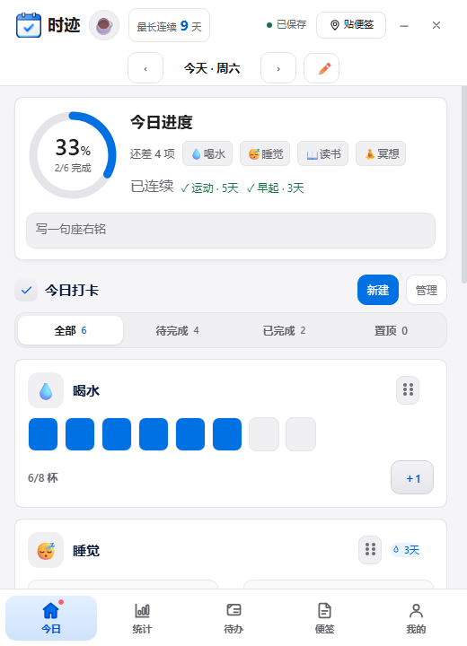
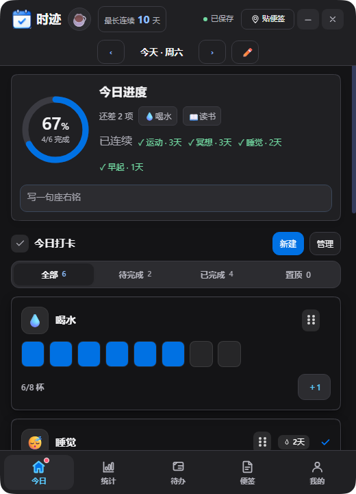
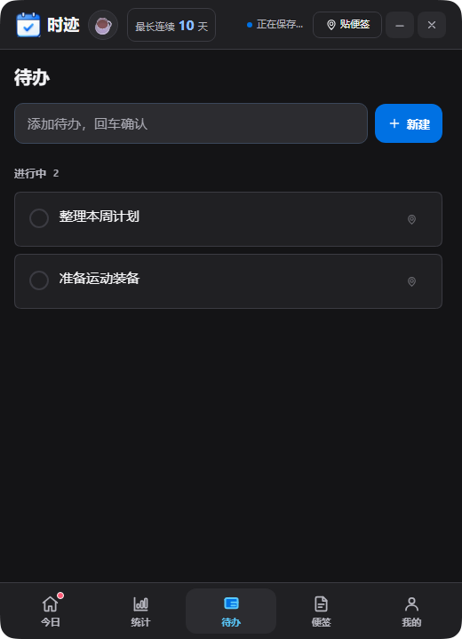
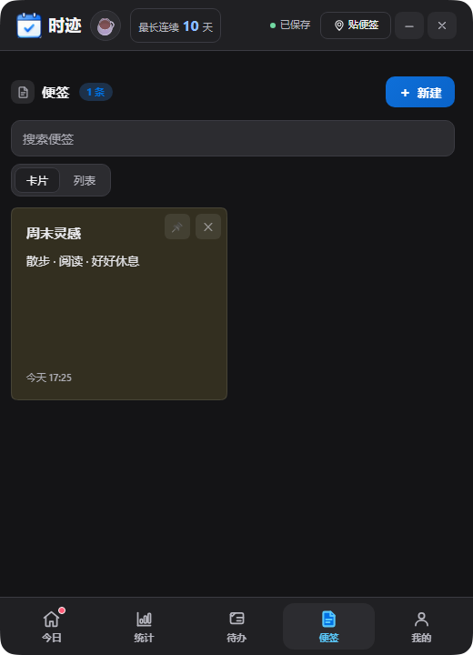

# 时迹

Windows 本地习惯打卡、待办与桌面便签应用，基于 Electron，界面为中文。所有数据保存在本机，不联网、不上传。

## 界面预览



*截图均使用演示数据。*

| 深色模式 | 待办 | 便签 |
| --- | --- | --- |
|  |  |  |

## 下载

在 [Releases](../../releases) 页面下载：

- `shiji-1.0.0-Setup.exe`：安装版，安装后提供开始菜单与桌面快捷方式。
- `shiji-1.0.0-portable.exe`：便携版，双击直接运行。
- `SHA256SUMS.txt`：上述文件的校验值，可用 `certutil -hashfile 文件名 SHA256` 自行核对。

安装前请先退出旧版本；安装包未做代码签名，Windows 可能提示「未知发布者」，选择「更多信息 → 仍要运行」即可。

## 功能

- **习惯打卡**：布尔、计数、计时三类习惯，支持目标、执行日期、暂停与归档。
- **待办事项**：优先级、截止日期、子任务、置顶与快速添加。
- **便签**：富文本、图片、桌面贴纸；多张便签左右滑动翻页，可贴到桌面常驻。
- **统计**：连续天数、完成率、热力图与周期回顾。
- **数据**：本地存档、每日自动备份、手动导出与导入恢复。
- **其他**：深浅色主题、连续曲率圆角窗口、应用内新手引导。

## macOS 适配

macOS 版本正在开发：计划支持本机存档、通知和登录项。桌面贴纸暂以普通窗口呈现，不承诺 Windows 的桌面沉底效果。测试构建尚未经过 Apple 签名、公证或 Mac 实机验收，当前正式下载仅提供 Windows 版本。

## 从源码运行与打包

需要 Windows + Node.js 22 或更高版本。

```powershell
npm ci
npm run electron:install   # 下载 Electron 运行时
npm start                  # 开发模式启动
npm run dist               # 打包便携版到 artifacts/portable-staging-1.0.0
node scripts/build-installer.cjs   # 生成安装包，需要 NSIS 的 makensis.exe
```

安装包编译默认查找 electron-builder 的 NSIS 缓存目录，也可用环境变量 `NSIS_EXE` 指定 `makensis.exe` 路径。

## 目录结构

| 路径 | 说明 |
| --- | --- |
| `main.js`、`preload.js` | Electron 主进程与受限 IPC 桥接 |
| `habit.html`、`ui.js`、`js/`、`styles/` | 界面与交互逻辑 |
| `store.js`、`habit-rules.js`、`backup-history.js` | 本地数据存储与共享规则 |
| `安装包制作/` | NSIS 安装脚本、图标与安装许可 |
| `scripts/` | 打包与版本同步脚本 |
| `desktop-layer.exe` | 桌面贴纸沉底辅助程序，随包分发 |

## 数据位置

默认存档在 `%APPDATA%\habit-lab\`（`data.json`、`images\`、`auto-backup\`）。便携模式下数据改存到程序旁的 `data\` 目录。安装和升级会保留存档；卸载默认保留数据，但选择删除数据时会移除默认存档。迁移、升级或卸载前建议先导出备份。

## 许可证

[MIT](LICENSE)，作者 **Velpro**。允许商用、修改与分发，须保留版权声明与许可证全文。随包的 `desktop-layer.exe` 为桌面贴纸辅助程序，仅以二进制形式分发；其余第三方组件遵循各自许可证。
